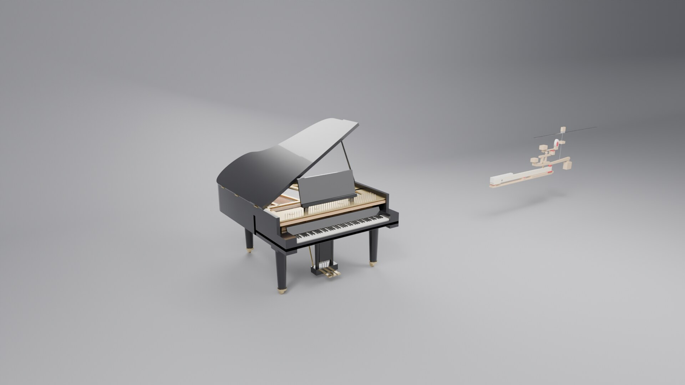
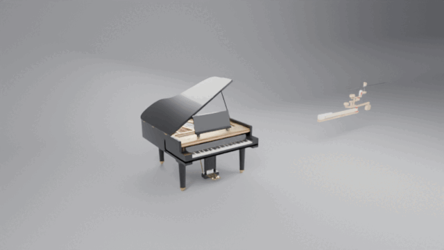
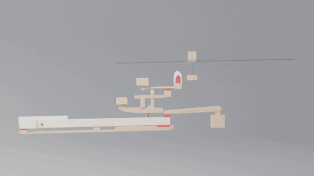
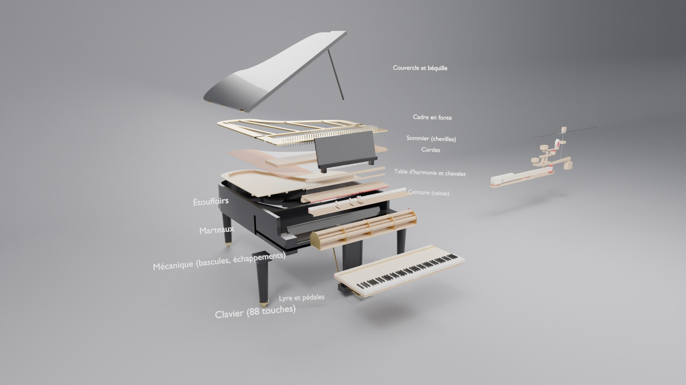
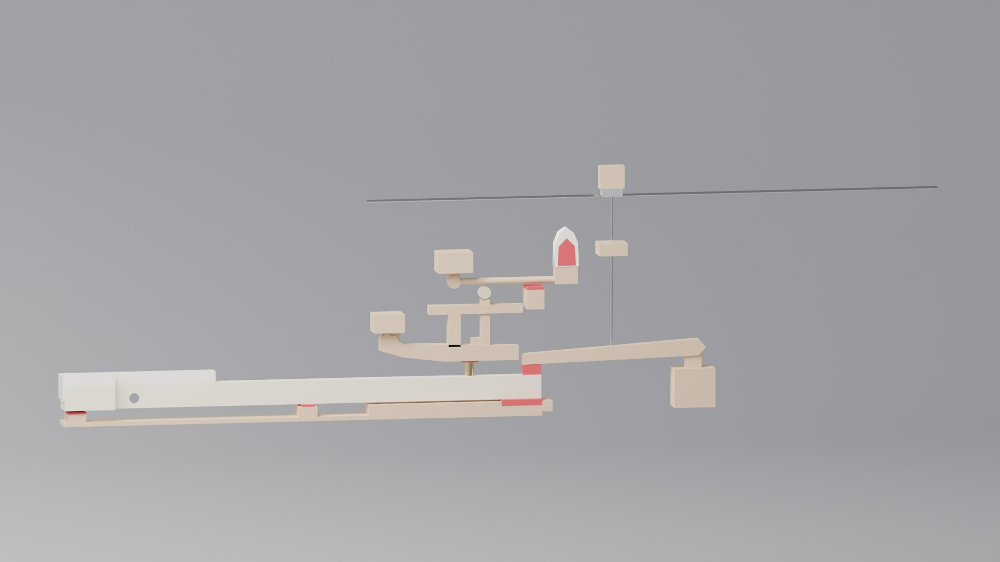
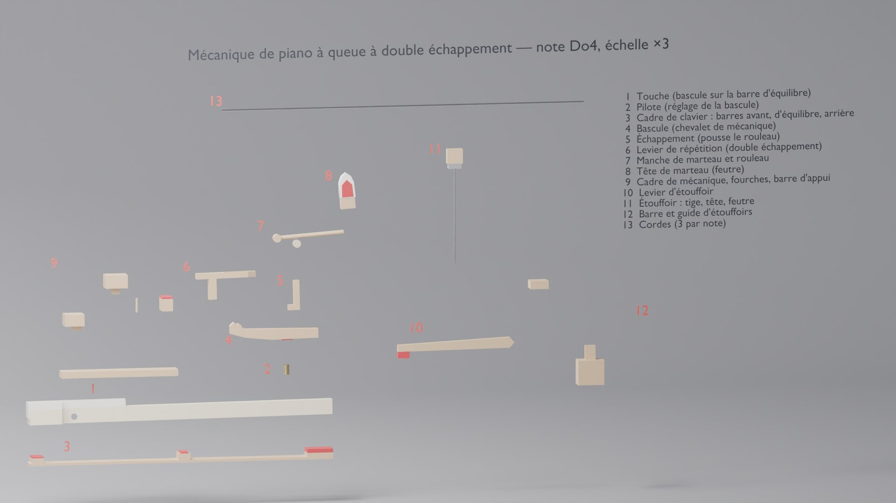

# Piano à queue 3D — mécanique et vue éclatée (Blender)

`piano_a_queue.py` construit entièrement, par script, un piano à queue avec sa
mécanique à double échappement, animée, et deux vues éclatées.
`piano_a_queue.blend` est la scène déjà générée, à ouvrir directement.

C'est le modèle source du piano de L'Atelier : `DetailedObjects.piano`, dans
`index.html` à la racine du dépôt, en est le portage three.js (mêmes cotes,
mêmes rapports de leviers). Si vous modifiez une cote ici, reportez-la là-bas.
Le dossier `apercu/` contient une visionneuse web autonome du modèle exporté
(`apercu/index.html`, servie aussi par Netlify sous `/blender/piano/apercu/`).



| Éclatement du piano | Éclatement de la mécanique |
|---|---|
|  |  |





## Ouvrir / générer

* **Le plus simple** : ouvrir `piano_a_queue.blend` dans Blender, puis appuyer
  sur **Espace** pour lire l'animation.
* **Régénérer la scène** : Blender > onglet *Scripting* > *Ouvrir*
  `piano_a_queue.py` > *Exécuter* (▶). La scène est vidée puis reconstruite.
* **En ligne de commande** :

  ```sh
  blender --python piano_a_queue.py                              # ouvre Blender avec la scène
  blender -b --python piano_a_queue.py -- --sauver piano.blend   # génère le .blend
  blender -b --python piano_a_queue.py -- --rendu rendus/ --images 1,200,350,440 \
          --moteur CYCLES --echantillons 64                      # rendus d'images
  ```

Testé avec Blender 5.2 ; le script vise aussi Blender 4.2 et plus récent.

## Commandes

Dans la vue 3D, barre latérale (**N**) > onglet **Piano** :

| Curseur | Effet |
|---|---|
| **Piano entier** (`explosion`) | 0 = piano assemblé, 1 = vue éclatée de tous les sous-ensembles |
| **Mécanique (vitrine)** (`explosion_detail`) | éclate pièce par pièce la mécanique agrandie ×3, avec repères numérotés et légende |
| **Enfoncer la touche (vitrine)** (`appui_demo`) | enfonce la touche de la vitrine : tout le mécanisme suit |

Les mêmes propriétés se trouvent sur l'objet `PIANO_Controle` (Propriétés de
l'objet > Propriétés personnalisées). Comme ces curseurs sont animés pour la
démo, le bouton **Mode manuel** retire leur animation pour les piloter à la
main. Les boutons **Vue générale** et **Vitrine** changent de caméra.

> Le panneau est enregistré dans le .blend (texte `piano_panneau.py`). Si
> Blender bloque l'exécution automatique des scripts, autorisez-la à
> l'ouverture, ou exécutez ce texte depuis l'éditeur de texte.

## Animation de démonstration (520 images, 24 i/s)

| Images | Contenu |
|---|---|
| 1–95 | Piano assemblé : il joue « Au clair de la lune » (touches, marteaux et étouffoirs bougent) |
| 95–165 | Éclatement progressif : couvercle, cadre, sommier, cordes, table, étouffoirs, marteaux, mécanique, clavier, lyre, pieds |
| 165–265 | Vue éclatée : la mélodie rejoue, on voit la mécanique travailler |
| 265–330 | Remontage |
| 335–520 | Caméra « Vitrine » : la mécanique d'une note s'éclate, la touche est enfoncée plusieurs fois, puis tout se remonte |

## Ce qui est modélisé

**Piano** : ceinture et caisse laquées, barrages, couvercle avec abattant
replié, béquille, pupitre, cylindre (couvre-clavier), joues, liteau, trois
pieds à roulettes, lyre avec trois pédales ; cadre en fonte (barre de capo,
ceinture, traverses, rosaces), sommier, 216 chevilles, pointes d'accroche,
cordes (1, 2 ou 3 par note ; cordes filées cuivre dans les graves), table
d'harmonie en épicéa avec ses barres, chevalet.

**Clavier** : 88 touches (52 blanches, 36 noires) à leur forme réelle,
contrepoids en plomb, cadre de clavier (barres avant, d'équilibre et arrière
avec leurs feutres).

**Mécanique (×88)** : pilote, bascule, échappement, levier de répétition,
marteau (manche, rouleau, tête en feutre), levier d'étouffoir, étouffoir
(tige, tête, feutre) — pas d'étouffoirs sur les 19 notes les plus aiguës,
comme sur un vrai piano — cadre de mécanique, fourches et barres.

**Cinématique** : chaque touche pivote sur la barre d'équilibre. Des drivers
transmettent son mouvement aux autres pièces :

* bascule = touche × 2,13 (le pilote la soulève) ;
* marteau = touche × 6,4 (l'échappement pousse le rouleau). La hauteur des
  cordes est calculée pour que le feutre les touche juste en fin de course ;
* l'échappement bascule dans les 15 % de course finaux (échappement) ;
* le levier d'étouffoir est soulevé par la queue de la touche, ce qui lève
  l'étouffoir des cordes.

Tous les drivers sont des expressions simples : ils fonctionnent même si
l'exécution automatique des scripts Python est désactivée.

## Organisation de la scène

Chaque sous-ensemble a sa collection et un empty `GROUPE_…` qui porte son
déplacement d'éclatement. Pour changer une trajectoire, modifiez la liste `G`
dans `build_piano()` (décalage x, y, z et retard). Pour la vitrine, ce sont les
appels à `part()` dans `build_showcase()`. Les cotes sont regroupées en tête
du script : largeur des touches, enfoncement, position des axes, etc.
